# 24. UI/UX redesign: every page

Written 2026-10-27. Mock-ups are in `docs/redesign/mockups/`; their HTML source is in `docs/redesign/mockup_source/`.

## The verdict

The app has strong data and a weak first impression. Today it reads like a stats database: correct, complete, and tiring. People come with one question, "what should I look at for tonight's games?", and we make them dig for it. The redesign turns every page around that question: answer first, detail on tap.

We reviewed all 16 user screens and the admin panel, as built in the scaffold and as specified in docs 01, 02, 04 and 20 to 23. Seven problems repeat on almost every page.

| # | Problem | Where it shows | What it costs |
| --- | --- | --- | --- |
| 1 | **No clear starting point.** Every page opens with a title and a list. Nothing says "start here". | Today, Insights, Finder, League | People scroll, skim, and leave without one useful take-away. |
| 2 | **Numbers without meaning.** A 64% or a 13.2 sits alone, with no "is that good?" | Forecast cards, matrix, player page | People cannot tell a strong forecast from an ordinary one. |
| 3 | **Too many separate lines.** One player shows up three times for three thresholds. | Insights, match page, player page | Feels like duplicates. Hides the one line that matters. Fixed in the data (cards); the screens must follow. |
| 4 | **Filters built like a form.** Long panels of dropdowns before any result. | Finder, Insights, matrix | Slow on a phone. People give up before the first result. |
| 5 | **Time is hidden.** The day is buried, and live, upcoming and finished look the same. | Today, Live, match page | People miss kick-offs and do not notice what changed. |
| 6 | **Same weight everywhere.** Every card, row and number has the same size and colour. | All lists | Nothing stands out, so nothing gets read. |
| 7 | **Desktop first.** Wide tables squeezed onto phones. | Matrix, squad grid, compare | Most visits will be on phones, on match day, with one hand. |

**The principles of the redesign:**

1. **Answer first.** The top of every page answers the question the page exists for, in one line or one card.
2. **One player, one card.** Lines live inside the card. The card leads with the line that matters most.
3. **Every number gets context.** A percentage comes with a label (Strong, Solid, Watch), a bar, and what is usual for that player or team.
4. **Time is the spine.** A date scroller at the top of every match-based page. Live is always visible when something is live.
5. **Filters are chips, not forms.** Quick chips on top for the common choices; everything else in one bottom sheet.
6. **Thumb first.** Key actions sit in the lower half of a phone screen. Swipe between days and tabs.
7. **Calm, then loud.** A quiet base, with colour reserved for three things: live, tier, and change (up or down).
8. **Honest by design.** Analysis only. No betting words, no countdown pressure. The track record is one tap from every forecast.

## Across the whole app

### The judged surface is the phone

Settled, so that it stops being re-decided per screen. Every layout question is answered at 390px
first and desktop inherits the answer. The reason is not taste: anything that survives the narrow
width survives the wide one, and the reverse is not true -- truncation and horizontal overflow only
ever bite on the phone, and a desktop-first decision reaches them last. The 70/30 fixture split is
the worked example: right at 1440, and it has to ease to 64/36 below 1280 or the market text gives
way.

Desktop may then earn extra columns the phone has no room for -- Most likely's opponent column is
one -- but it earns them on top of a layout that already works, never instead of one.

If the owner's own traffic ever says otherwise by a clear margin, this is the line to change, and
it is one line.

### Navigation

We cut the bottom bar from six items to five, each a verb people already have in mind.

| Tab | Holds | Why |
| --- | --- | --- |
| **Today** | Fixtures by day, live scores in place, top insights | The home. Most visits start and end here. |
| **Insights** | The forecast feed (cards) | The core product, one tap away. |
| **Finder** | Search players and teams by a stat line | The power tool. |
| **Explore** | Leagues, teams, players, Compare, Track Record | Everything you browse, in one place. |
| **You** | Following, saved, notes, account | Personal things together. |

- **Live** stops being a tab. A red "2 live" pill floats above the bottom bar on every page while something is live. Tap it: a bottom sheet with live scores, no page change. The full Live page stays at /live.
- **Search** becomes a magnifier in the header, on every page. It opens a full-screen overlay with recent searches, then results grouped as Players, Teams, Leagues.
- On desktop the same five items sit in a left rail, with the page in the middle and a right column for "Following" and live scores.

### Header

- Left: logo. Middle: the page's own context (a league picker, a date, a team name). Right: search and the account avatar.
- The header shrinks to 44 px on scroll and comes back on scroll up.
- The disclaimer leaves the header and lives in the footer and on each forecast's detail sheet.

### Visual language

- **Base:** keep the dark-first palette in doc 04. Raise contrast on secondary text a step; today it is too faint at 13 px on phones.
- **One accent per meaning:**
  - teal = Strong;
  - blue = Solid;
  - amber = Watch;
  - red = live, and "down";
  - green = "up". Nothing else is coloured.
- **Numbers:** tabular figures everywhere. The key number on a card is 28 px; everything else is 14 to 16 px.
- **Crests and photos** do a lot of work. Every team row shows its crest. Every player card shows the player's photo or initials. This alone makes the app feel 10 times richer (doc 19).
- **Cards, not tables, on phones.** A table becomes a stack of cards below 640 px wide, unless it is a grid people compare across (matrix, squad grid). Those keep a sticky first column and scroll sideways with a fade on the right edge, so people know there is more.

### Motion and feedback

- 150 ms fades; no bouncing.
- A score that changes flashes once (the number pulses for 1 s).
- A new insight slides in at the top with a "3 new" chip, never shifting what people are reading.
- All motion is off under "reduce motion".

### Empty, loading and error states

- **Loading:** skeletons of the exact card shape, never spinners.
- **Empty:** says why and offers the next step. Example: "No Premier League games today. Next: Saturday, 10 games", with a button.
- **Error:** one sentence and a "Try again" button. The last good data stays on screen with "Updated 12:40".

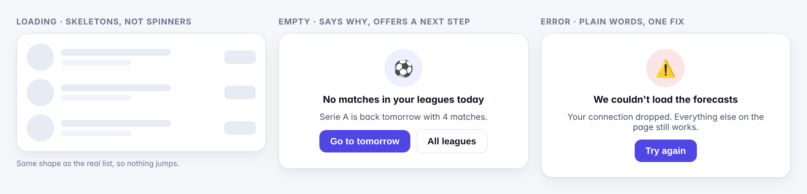

*Loading shows the shape of what is coming. Empty says why and gives a next step. Error says what broke in plain words and offers one fix.*

### Footer and the weekly e-mail

The current e-mail box sits under every page with a generic promise and a separate tick box. We make the promise concrete (what, when, how short), show a preview of the e-mail, and keep one field and one button with the consent line under it. The footer carries the "Not betting advice" line and the links that left the main menu.

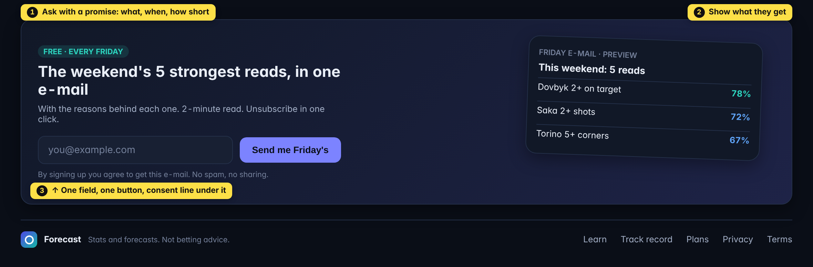

*The e-mail box sells the e-mail by showing it. Check the consent wording against Canada's anti-spam law (CASL) before launch.*

### Phone-first patterns we use everywhere

| Pattern | Use it for | Instead of |
| --- | --- | --- |
| Swipe left/right | Changing day, changing tab | Small arrows |
| Bottom sheet | Filters, forecast detail, live scores, lineups | New pages and pop-ups |
| Chips row (scrolls sideways) | League, stat, venue, window | Dropdowns |
| Range slider | Minimum likelihood, games window, minutes played | Number fields |
| Segmented control (2 to 3 options) | Last 5 / Season, Home / Away / All | Dropdowns |
| Pull to refresh | Today, Live, Insights | A refresh button |
| Sticky "compare" tray | Picking 2 teams or players anywhere | A separate picker page |

## Page by page

Each page: its one job, what is lacking now, and the redesign from top to bottom.

The mock-ups below use our current colours, font and logo, in light and dark mode, so they show the redesign, not a new brand. The yellow numbered tags explain each change; they are notes, not part of the design. Names and numbers are examples.

### 1. Today (home)

**Job:** "What is on, and what is worth a look?"

**Lacking now:**

- The date strip is a row of plain buttons.
- Fixtures are a flat list, with live, upcoming and finished looking alike.
- The "insights" count is a small green word that nobody taps.

**Redesign, top to bottom:**

1. **Date scroller.** A swipeable strip: Yesterday, Today, Tomorrow, then weekdays, with a dot under days that have games in leagues you follow. Swipe the list itself left or right to change day. A calendar icon at the end opens a month view for jumping further.
2. **"Top 3 for today" carousel.** Three swipeable forecast cards, the strongest of the day: player photo, "2+ shots on target", 78%, Strong. One line of why. A "See all 24" link goes to Insights, filtered to today.
3. **Live strip** (only while something is live). A thin row of live mini-scores, scrolling sideways. Tap one to open its match.
4. **Fixtures by league.**
   - League header with logo and a collapse arrow; leagues you follow come first.
   - Each match row: the time or a live clock, two crests and names, and the score once started.
   - Under the teams, a thin three-colour bar for win/draw/loss, with the favourite's percentage printed.
   - A small "5 insights" chip on the right.
5. **Filter chips** above the list: All · Following · Live now · Has insights. Pinned under the header on scroll.

**Why it is better:** the first screen gives three answers (best forecasts, what is live, what is on) without a scroll.

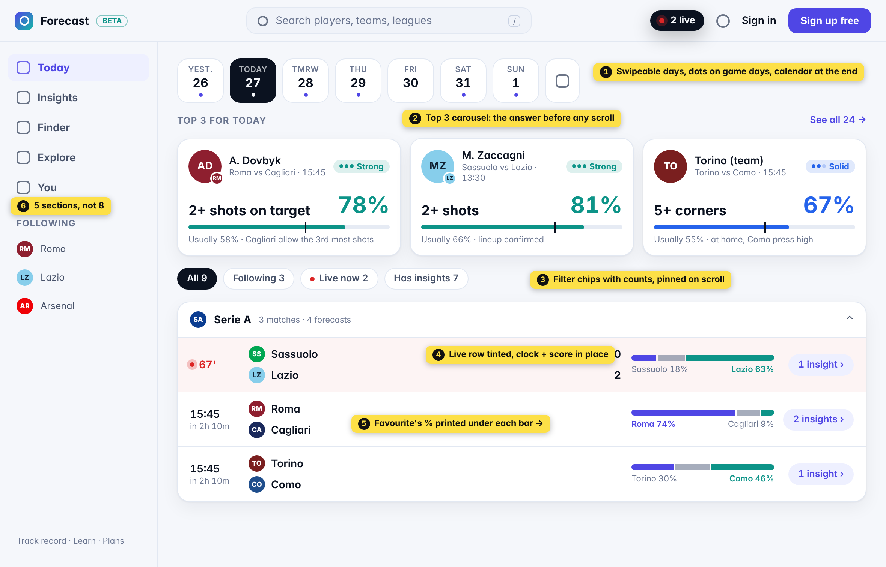

*Today on a computer, light mode. Compare with the current page: the same three Serie A matches, but the strongest forecasts lead, live matches stand out, and every bar says who is favoured.*

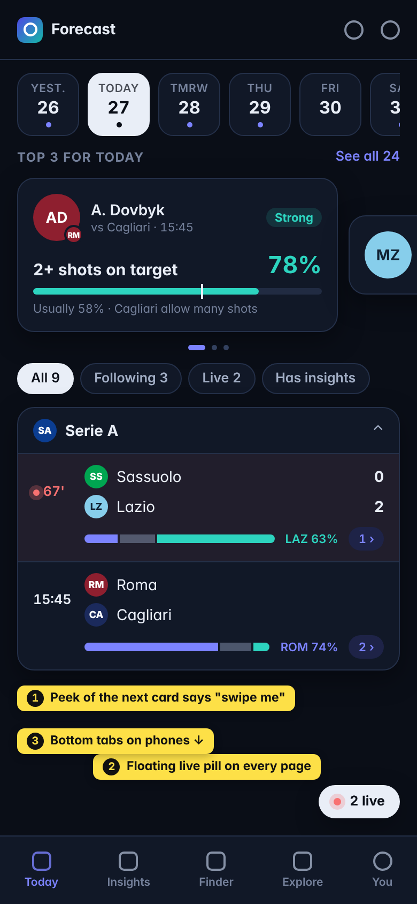

*Today on a phone, dark mode: bottom tabs, a swipeable Top 3, and the floating live pill.*

### 2. Live

**Job:** "What is happening right now?"

**Lacking now:**

- Works, but feels like a list.
- Changes are easy to miss.
- Events only show after a tap.

**Redesign:**

- Opens as a **bottom sheet** from the floating live pill on any page; the full page is at /live.
- Each live match is a **live card**:
  - big score;
  - the clock with a pulsing dot;
  - the last event in one line ("Goal, Saka 67'");
  - a thin momentum bar of events by half.
- A goal **flashes** the card once and moves it to the top for 30 seconds.
- "Follow" a match: it sticks to the top, and we send an alert on goals and red cards, if alerts are on.
- Tap opens the **match centre** (the match page in live mode).
- Finished matches drop to a collapsed "Finished (6)" group. Upcoming ones sit under "Later today".

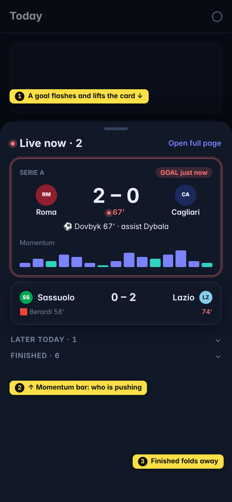

*The live sheet opens from the live pill on any page. A goal lifts and outlines the card.*

### 3. Match page (match centre)

**Job:** "What should I expect from this game, and what happened?"

**Lacking now:**

- One long scroll of forecasts.
- Context (injuries, form, stakes) is scattered.
- No sense of before, during and after.

**Redesign:** the page changes its first screen with the match state.

| State | Hero (top) | First tab |
| --- | --- | --- |
| Before (more than 1 hour) | Crests, kick-off countdown, win/draw/loss bar, "Context" chips ("Relegation fight", "Nothing to play for") | **Preview** |
| Lineups out | Same, with a green "Lineups confirmed" tag; forecasts update and say so | **Preview** |
| Live | Big score, clock, last event, live strip of events | **Live** |
| Finished | Final score, half-time score, "How our forecasts did: 7 of 9" | **Recap** |

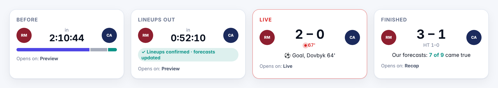

*One page, four states. The hero and the first tab change with the match.*

Tabs (sideways, swipeable): **Preview · Forecasts · Lineups · Stats · Head-to-head**, and **Live** or **Recap** when relevant.

- **Preview tab:**
  - three plain sentences ("Arsenal: 4 wins in the last 5"; "Leeds have nothing left to play for"; "Saka missed the last 2, likely out");
  - then "Out / Doubtful" with photos;
  - then the radar of the two teams (Compare, built).
- **Forecasts tab:**
  - player cards grouped by team, with a toggle **By team / By market**;
  - a **minimum likelihood slider** (50% to 95%) at the top filters the cards live.
- **Lineups tab:**
  - a **pitch view** with shirt numbers and photos; tap a player to see his forecast card;
  - before lineups: "Predicted eleven" drawn faded, with each player's chance to start.
- **Stats tab:** team stat bars head to head (shots, on target, corners, possession), each a split bar with both numbers.
- **Head-to-head tab:** last 5 meetings as small result chips, plus the tally.

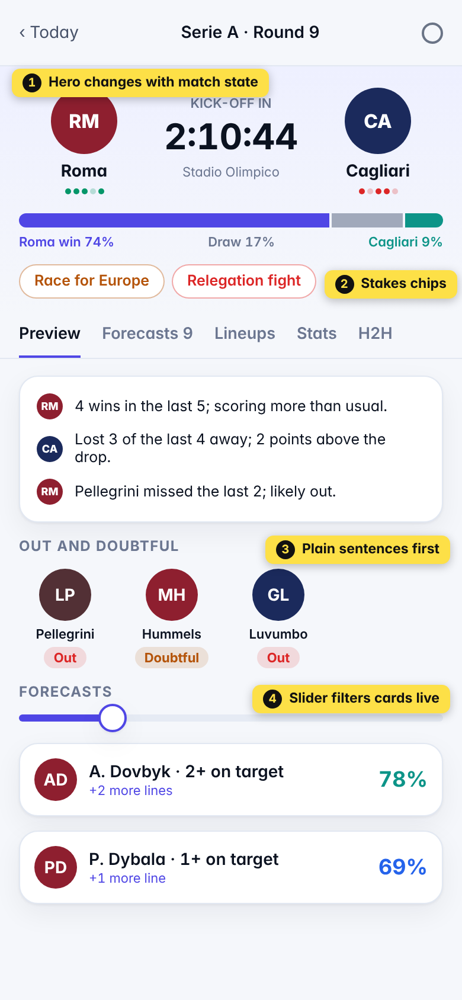

*Match centre before kick-off: countdown, who is favoured, stakes, three plain sentences, who is out, then forecasts filtered by the slider.*

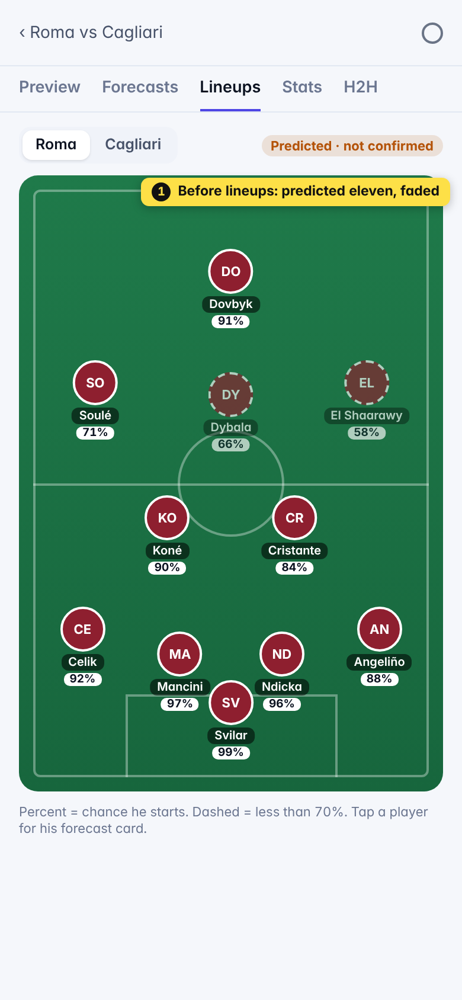

*Lineups tab before the lineup is out: the predicted eleven, each with his chance to start. Unsure starters are faded and dashed. When the real lineup arrives, the tag turns green and every player is solid.*

### 4. Insights

**Job:** "What are the strongest forecasts across the leagues I care about?"

**Lacking now:**

- A long, flat list.
- Filters are a form.
- The same player shows up several times (fixed in the data; the screen must use `cards`).

**Redesign:**

1. **Day scroller** (the same component as Today).
2. **Chips row:** League (multi-pick) · Market (Shots, On target, Tackles, Corners, Team shots) · Tier (Strong, Solid, Watch).
3. **"More filters" bottom sheet:**
   - minimum likelihood slider;
   - position chips (GK, DEF, MID, FWD);
   - Home / Away;
   - "Lineup confirmed only" switch.
4. **Feed of forecast cards** (see Components). Each card has the headline line large, and the other lines folded inside ("+2 more lines").
5. **Sort:** Most likely · Biggest rise vs usual · Kick-off time.
6. **View toggle:** Cards / Compact list, for power users who scan many.

**Why it is better:** a phone user gets to a filtered, readable feed in two taps, not twelve.

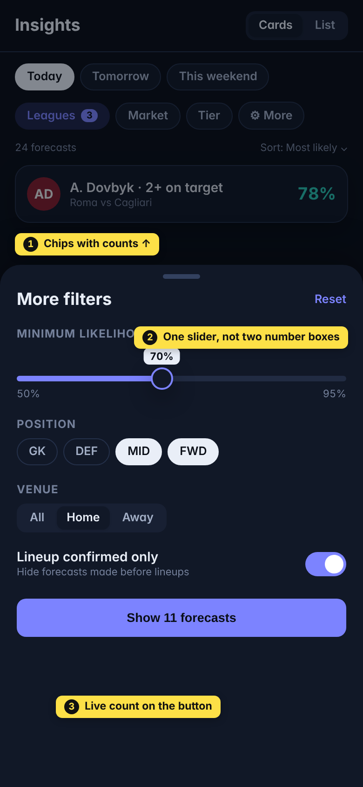

*Insights: quick chips on top, everything else in one bottom sheet. The button shows how many forecasts match before you close it.*

### 5. Forecast Finder

**Job:** "Which players hit this stat line, and how often?" This is the PlayerStats-style power tool.

**Lacking now:** a panel of 12 fields before any result. On a phone it is a wall.

**Redesign as a sentence builder.** The top of the page reads like a sentence, and each underlined part is a tap target:

> Players with **2+** **shots** in **7 of the last 10** games, **at home**, playing **today** in **Premier League**

- Tap **2+**: a stepper (1+ to 6+).
- Tap **shots**: a list of stats.
- Tap **7 of the last 10**: two sliders, games window (5 to 20) and usual rate.
- Tap **at home**: Home / Away / All.
- Tap **today**: the date scroller.
- Tap **Premier League**: league chips.

The results update live under the sentence:

- Each row: player photo, name, team crest, a **hit-rate strip** of the last 10 games (10 small squares, filled when hit), "7/10", and the forecast for the next game when we have one.
- Mode switch above the results: **Usual rate · Streak · Our forecast**.
- Results can be saved as a **preset** ("My corner kings") and appear as chips next time.

**Why it is better:** people read the query in plain English, and the most common tweak is one tap.

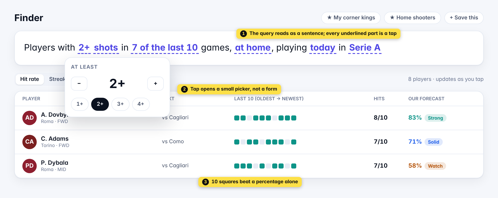

*Finder: tap any underlined word to change it. Results update under the sentence.*

### 6. Explore (Leagues)

**Job:** "Take me to a league, team or player."

**Lacking now:** a text list of leagues grouped by country.

**Redesign:**

- A grid of **league tiles**: logo, name, and the country flag.
- Below it, **"Your teams"**: a row of crests you follow.
- Below that, quick links: **Compare two teams**, **Track record**, **Learn**.
- Search on the same page filters the tiles as you type.

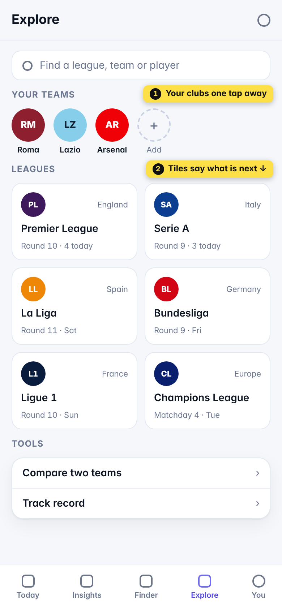

*Explore: your clubs first, then league tiles that say what is next, then the tools.*

### 7. League

**Job:** "How is this league going, and who stands out?"

**Lacking now:**

- It opens on a wide table (the matrix).
- No league table or standings view.
- Tabs carry no counts.

**Redesign.** Tabs: **Overview · Table · Teams (matrix) · Fixtures · Leaders.**

- **Overview** (new, the default):
  - the next round's fixtures as small cards;
  - "Hot right now": the 3 teams with the biggest rise in results form, as chips with arrows;
  - the top 3 in shots and in tackles, with photos.
- **Table:** the standings with a form column (5 coloured dots) and zone colour bands (top, relegation).
- **Teams (matrix):** keep the heat-map, with three changes.
  - On phones, a **"pick a stat" chip row** shows ONE stat as a ranked bar list (crest, name, bar, value). The full grid is behind "Show all stats".
  - A legend strip at the top: light = bottom of league, dark = top.
  - Ticking two teams shows the radar (built); the tray at the bottom says "2 selected · Compare".
- **Fixtures:** grouped by round, with a round scroller (Round 10, 11, 12).
- **Leaders:** stat chips (Shots, On target, Tackles, Goals). Each shows a ranked list with photos and a **per 90 / total** switch and a **minimum minutes slider**.

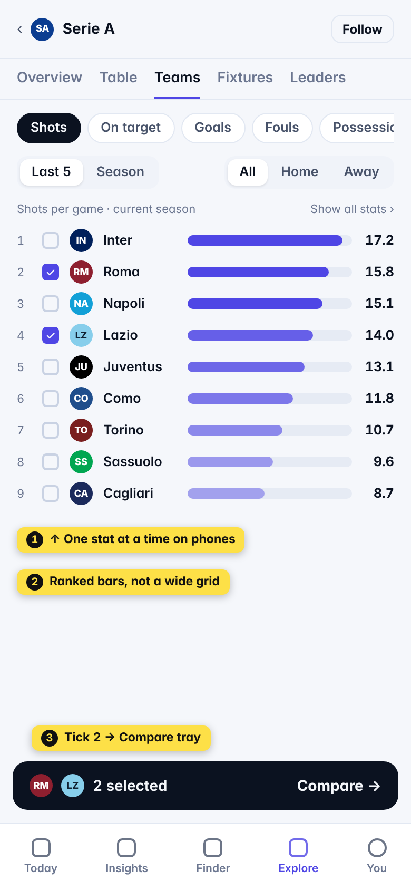

*League, Teams tab on a phone: one stat as ranked bars instead of the wide matrix. Tick two clubs and the Compare tray appears.*

### 8. Team

**Job:** "How does this team play, and who matters?"

**Lacking now:**

- The squad grid is a wide table with the same weight everywhere.
- The team's story (form, style, injuries) is not told.

**Redesign:**

- **Hero:**
  - crest, name, league position, and the last 5 as coloured dots;
  - the next match card with a countdown;
  - **Follow** button.
- **Story strip:** three plain sentences built from our data ("Scoring more than expected lately", "Concedes the 4th fewest shots", "2 players out").
- Tabs: **Overview · Squad · Stats · Fixtures.**
- **Squad (the squad grid):**
  - Default view is **cards by position** (GK, DEF, MID, FWD), each card showing photo, last-5 mini bars for the chosen stat, and the next forecast.
  - A **Grid** toggle gives the PlayerStats-style grid (rows = players, columns = last N games).
  - In the grid, a **games slider** (5 to 10, plan limit shown) and a **stat chip row** sit on top. A cell is filled and darker when it reaches the line you choose, and the line is set with a stepper (1+, 2+, 3+).
- **Stats:** team totals as "for vs against" split bars per game; a **Last 5 / Season** segmented control; a **Home / Away / All** control.
- **Fixtures:** past results as chips (W/D/L and score), upcoming with our win/draw/loss bar.

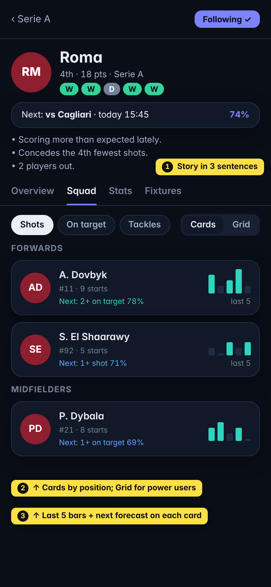

*Team page: form as W/D/L chips, the next match, the story in three lines, then squad cards by position.*

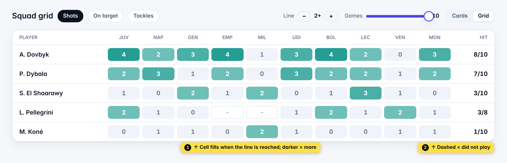

*The Grid view for power users: rows are players, columns are the last games. Set the line with the stepper and the games with the slider.*

### 9. Compare

**Job:** "How do these two stack up right now?"

**Lacking now:**

- The pickers are two dropdowns.
- The radar, insights and table sit in one long scroll.

**Redesign:**

- **Pickers become a search field per side**, with recent and followed teams as chips. A swap button sits between them.
- **Radar first**, full width, with the Last 5 / Season control on it (built).
- **"Edge" bars:** for each stat, one horizontal bar split at the middle, leaning toward the better team, with both numbers at the ends. People read these faster than a table.
- **"What stands out":** at most 4 sentences, with the biggest gap first.
- **"As a fixture" switch** becomes a clear toggle in the hero: "Arsenal at home vs Chelsea away".
- Add **player vs player** with the same layout (photos, radar of player stats per 90). This is a common ask on stat sites.

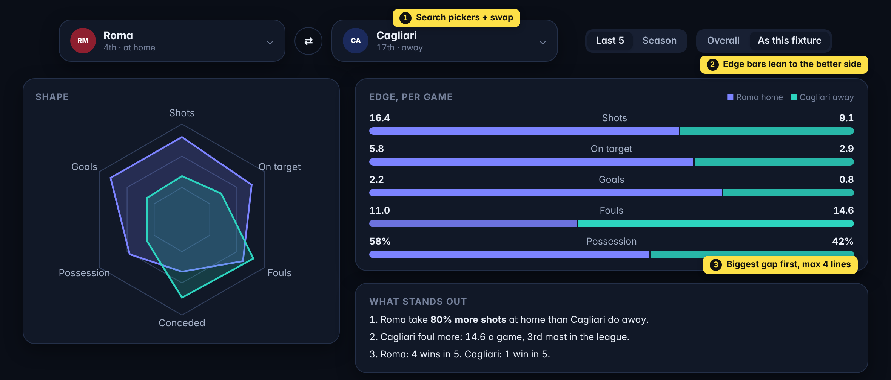

*Compare: the radar we built, edge bars that lean toward the better side, and the biggest gaps in words.*

### 10. Player

**Job:** "How is this player doing, and what is likely next game?"

**Lacking now:** a list of forecasts and a history table.

**Redesign:**

- **Hero:**
  - photo, name, shirt number, position, team crest;
  - availability tag ("Likely out", "Doubtful", "Starts usually");
  - **Follow** and **Add note** buttons.
- **Next game card:** his forecast card for the next match (headline line plus the other lines), with "Chance he plays: 85%".
- **Form chart:** bars for the last 10 games of the chosen stat, a horizontal line at the chosen threshold, and hits coloured.
  - Stat chips: Shots, On target, Tackles, Minutes.
  - **Window slider:** 5 to 20 games.
  - **Filters:** Home/Away, Started only.
  - A hit-rate label above ("Hit 2+ shots in 7 of 10").
- **Season numbers:** 4 big tiles (per 90): shots, on target, tackles, minutes, each with the league rank ("12th of 240 forwards").
- **Game log:** a compact table, newest first, collapsible.

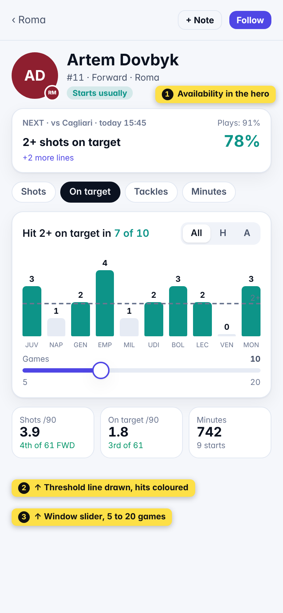

*Player: next game first, then a form chart with the line drawn in and a slider for how many games.*

### 11. Following (You)

**Job:** "What is happening with my teams and players?"

**Lacking now:** three separate lists.

**Redesign:**

- One **feed**, newest first, mixing:
  - next matches of followed teams;
  - new forecasts for followed players;
  - lineup news ("Saka starts");
  - results.
- A row of followed crests and photos at the top acts as a filter.
- **Saved forecasts** become a tab with outcomes once matches finish (hit or miss, plainly).
- **Notes** sit on the player page, and are listed here.

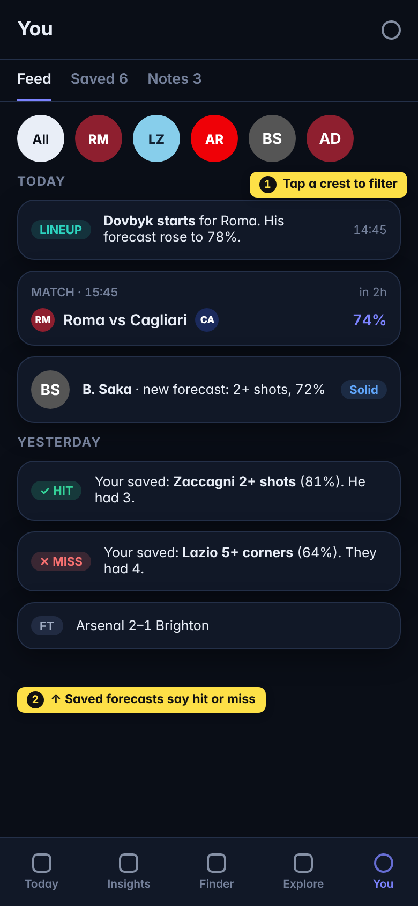

*One feed for everything you follow. Saved forecasts come back with a plain hit or miss.*

### 12. Track record

**Job:** "Can I trust these numbers?"

**Lacking now:** tier tables and a reliability chart, aimed at experts.

**Redesign:**

- One headline: "When we say 70%, it happens 71% of the time", from the real data, updated weekly.
- A **calibration chart** (said vs happened) with a plain caption.
- Tier tiles (Strong, Solid, Watch): how often each came true, and over how many forecasts.
- Filters by league and market, as chips.
- A **"How we got this"** link to Learn.
- Link to it from every forecast card's detail sheet ("Our record on this kind of forecast: 68 of 100").

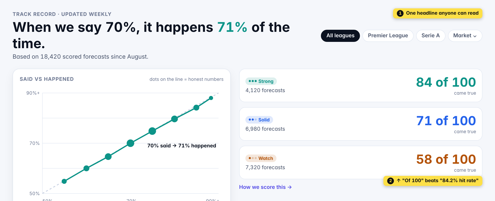

*Track record: one sentence anyone can read, a said-vs-happened chart, and each tier as "of 100". Numbers here are examples; the page reads them from scored forecasts.*

### 13. Search

**Job:** "Find a name fast."

**Redesign:**

- Full-screen overlay.
- Recent searches and followed items appear before typing.
- Results are grouped (Players, Teams, Leagues), each with a photo or crest.
- Typo-tolerant. Keyboard friendly on desktop (arrow keys, Enter).

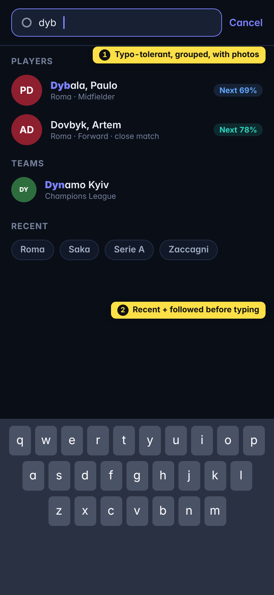

*Search: grouped results with photos and the next forecast, matched letters highlighted, recent searches below.*

### 14. Account, sign-up, sign-in

**Lacking now:** plain forms.

**Redesign:**

- Sign-up asks for email and password only, then a 3-step welcome:
  1. pick leagues;
  2. pick 3 teams to follow;
  3. turn alerts on or off. This fills Following on day one.
- Account becomes a settings list with clear sections and icons. Danger actions (delete account) are at the end, in red, with confirmation.

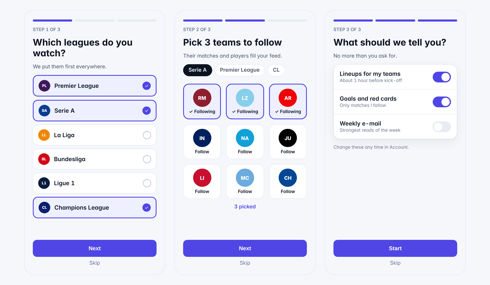

*The welcome after sign-up: leagues, three teams, alerts. Every step can be skipped. Day one, the Following feed is already full.*

### 15. Pricing

- Two columns on desktop, stacked cards on phone.
- What each plan unlocks, as plain rows with ticks.
- No countdowns or "only 3 left" (doc 03).
- Locked features across the app show a small padlock and "Part of Pro", which opens this page as a bottom sheet, not a new page.

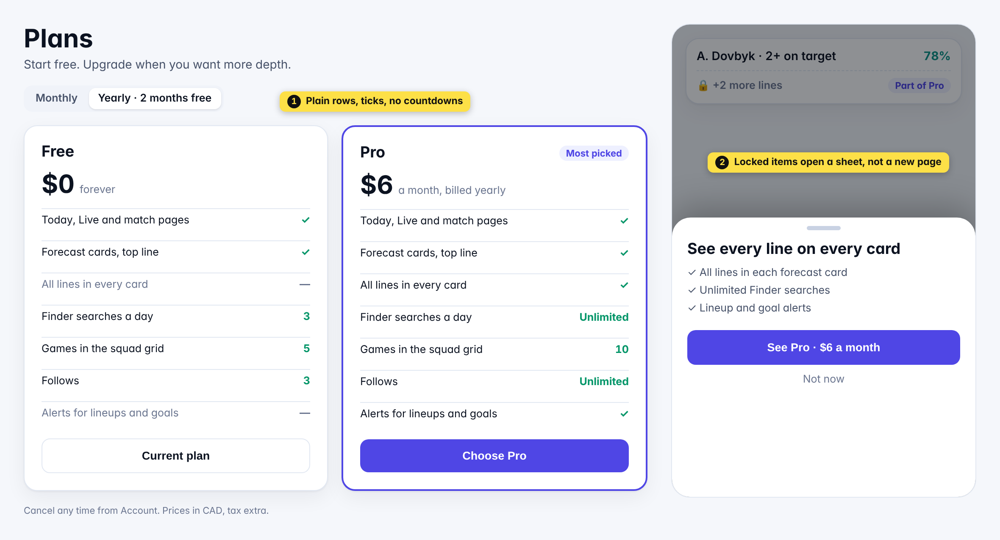

*Left: Plans as plain rows with ticks. Right: what a locked item does anywhere in the app. Prices and limits here are placeholders; the real ones come from Admin → Plans (doc 14).*

### 16. Learn

- Short articles with one picture each: "How to read a forecast card", "What Strong, Solid and Watch mean", "Why lineups change the numbers".
- Linked from the "?" icon on every card and chart.

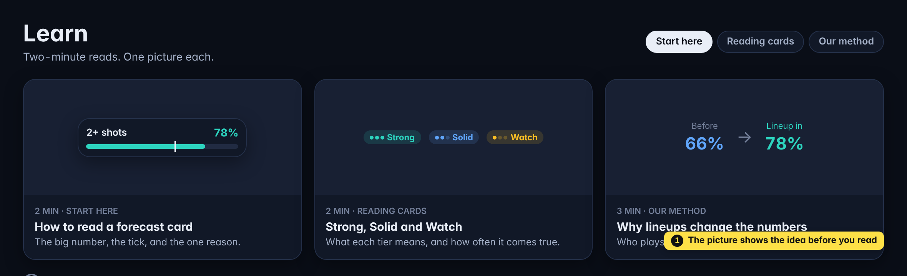

*Learn: short reads, each with a picture that shows the idea first.*

## Admin

The admin panel has 32 modules. The owner uses about six daily. We redesign around those six, and tuck the rest behind them.

- **Home = a health board, not a menu.** Six tiles, each green, amber or red with one line:
  1. Data ("PitchAPI: 1,240 of 5,000 calls; last sync 12:05");
  2. Live ("SportAPI: 612 of 1,800; 3 live");
  3. Engine ("Last run 12:10; 412 forecasts; map: default");
  4. Images ("14 to review");
  5. Users ("38 sign-ups today");
  6. Money ("Billing off"). Tap a tile to open its module.
- **One "Needs you" inbox** at the top: team matches to review (SportAPI and images), players to approve, failed jobs, issues. Each item has the action buttons on the card itself, so the owner never hunts for the screen.
- **Budget bars everywhere** an API is used: calls today against the limit, split by kind, with the time of the reset.
- **Settings with plain labels and grouped switches.** Each setting shows what it does in one line, its default, and "changed by X on date". A search box filters settings by word.
- **Engine screen:**
  - a simple panel of the four switches that matter (availability model, form and stakes, calibration, start model);
  - each switch shows its tested effect ("+8% better on player forecasts") and a link to the proof (docs 21 and 22).
- **Availability screen:**
  - pick a team, see its squad as photo cards;
  - tap a card to cycle Available, Doubtful, Out;
  - add a reason and an end date in a bottom sheet.
- **Phone use:** the bottom bar from doc 17 stays (Home, Needs you, Data, Engine, More). Tables become cards. Every destructive action needs a second tap.

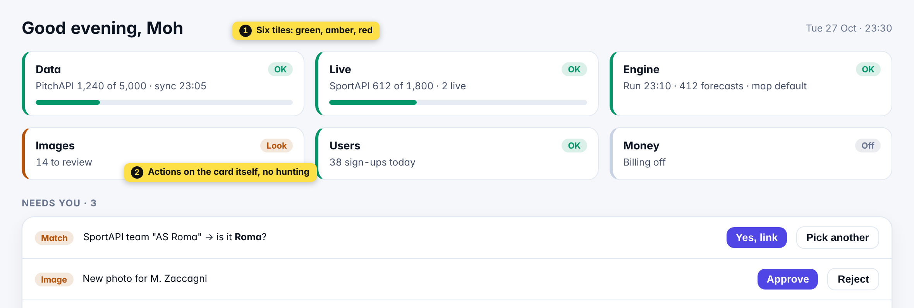

*Admin home: six health tiles and one inbox of things that need the owner, each with its buttons on the card.*

## Components to build once, use everywhere

Ten components carry the whole redesign. Building them first makes every page faster to build and consistent.

| Component | What it looks like | Used on |
| --- | --- | --- |
| **Forecast card** | Photo or crest at left. Headline line in large text ("2+ shots"). Big percentage with tier colour and a 3-dot tier mark. A thin bar under it showing the player's usual rate as a tick, so people see "above usual". One reason sentence. "+2 more lines" folds open. Tap opens the detail sheet. | Today, Insights, Match, Player, Following |
| **Forecast detail sheet** | Bottom sheet: all lines; the top 3 reasons as plain sentences; chance he plays; lineup status; last 10 games strip; "Our record on this kind of forecast"; Save, Note, Share. | Every forecast card |
| **Date scroller** | Swipeable day strip with dots on game days, plus a calendar button. Remembers the last day picked for the session. | Today, Insights, Live, Finder, League fixtures |
| **Chips row** | One row, scrolls sideways, multi-pick where it makes sense, with a count badge ("Leagues 3"). | All filtered pages |
| **Filter sheet** | Bottom sheet with sliders, segmented controls and switches, "Reset" and "Show 24 results" (live count). | Insights, Finder, League leaders |
| **Range slider** | Two-thumb or one-thumb slider with the value shown above the thumb and big touch targets (44 px). | Likelihood, games window, minutes, hit rate |
| **Hit-rate strip** | 10 small squares, oldest to newest, filled when the line was reached, with "7/10" beside it. | Finder, Player, Squad cards |
| **Win/draw/loss bar** | Three-part bar with the favourite's percentage printed; colour plus text. | Today, Match, Team fixtures |
| **Live card and live pill** | Score, clock with pulsing dot, last event; the floating "2 live" pill opens the live sheet. | Global, Live, Today |
| **Pitch view** | Formation drawn on a pitch, photos and numbers, tap for card; faded "predicted" state. | Match lineups |

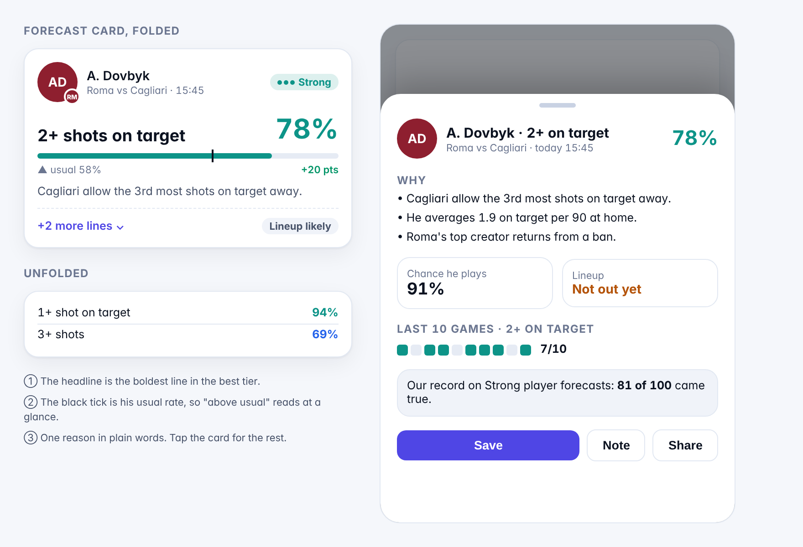

*The forecast card, the one component used most. Left: folded and unfolded. Right: the detail sheet a tap opens.*

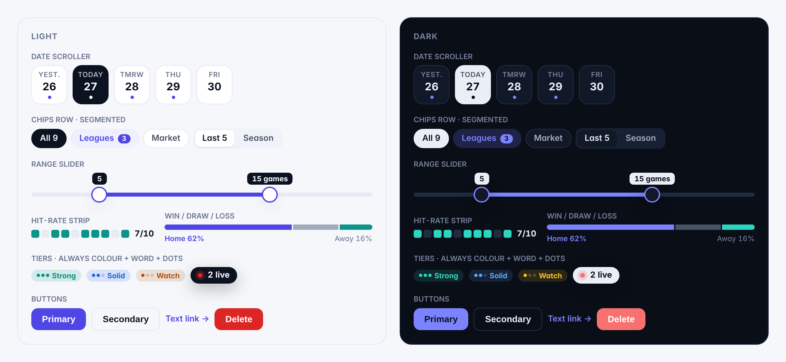

*The shared parts, side by side in both modes: date scroller, chips and segmented controls, range slider, hit-rate strip, win/draw/loss bar, tiers, live pill and buttons. Build these once and every page gets them.*

Already built and kept: crest and avatar with fallbacks (docs 19), team matrix (docs 20), radar (docs 20), match events timeline (docs 23), status chip (docs 23).

**Accessibility, built into each:** 44 px touch targets; every colour has a text label; screen-reader names on charts; contrast 4.5:1 on text; reduce motion respected.

## Priorities and how we measure better

We start with five quick wins that change every page at once, then the big changes one page at a time.

*(Impact-against-effort chart: see the online doc. The five quick wins are the Foundation step of the build order below.)*

The quick wins are mostly shared components (see the components section), so they lift every page together.

**Build order:**

1. **Foundation:** forecast card and detail sheet, date scroller, chips row and filter sheet, range slider, crests and photos everywhere, live pill.
2. **Match-day pages:** Today, then Insights, then the match centre (preview and live states first, recap after).
3. **Power tools:** Finder as a sentence builder, Team squad cards and grid, League overview and leaders.
4. **Retention:** welcome flow, follow feed, alerts, Track record headline on every card.
5. **Polish:** pitch view, player vs player, momentum bar, admin health board.

**How we know it is better** (measured with the analytics already built, doc 16):

| Measure | Why it matters | Target after redesign |
| --- | --- | --- |
| Time to first forecast card opened | Shows the answer is easy to reach | Under 10 seconds from landing |
| Share of visits that open a forecast detail | People find forecasts worth a look | Up by half |
| Finder searches finished per visit | The tool is usable on a phone | Up by half on phones |
| Day-7 return rate | People come back | Up by a quarter |
| Visits with a follow added (new users) | The welcome flow works | Half of new sign-ups |
| Pages per match-day visit | People move between Today, Live and match pages | Up |

The targets are our first guesses. We set real ones after two weeks of data on the current build.

**Before building:** test the top three pages (Today, Insights, match centre) as clickable mock-ups with 5 people on phones. Five sessions catch most of the big problems.
