# 26. Design review: Today, Insights, Finder, Explore

Written 2026-10-28. Pictures are in `docs/review/pictures/`; their HTML source is in `docs/review/mockup_source/`. Yellow numbered pins on the redesigns match the numbered lists under each picture. Names and numbers in the pictures are examples.

## Verdict

The new build is clean, calm and already better than most stats sites. What holds it back from world class:

- it shows data without telling a story;
- a few states are wrong;
- on a phone it will feel like a squeezed desktop.

**What works now.** Keep these:

- the date strip with dots;
- the win/draw/loss bars with the favourite's percentage;
- crests everywhere;
- the Finder sentence;
- the league tiles;
- the light, quiet palette.

**The 8 problems that matter most, in the order to fix them:**

| # | Problem | Where | Fix |
| --- | --- | --- | --- |
| 1 | Finished matches still look upcoming: kick-off time beside a final score, and our forecast never says if it was right | Today | Show FT, bold the winner, mark our forecast right or wrong |
| 2 | **Rounds are wrong:** "LaLiga Round 44", "Premier League Round 26" in October | Explore | Our internal round is a count of match dates, not the matchday. Show the provider's matchday, or the date only |
| 3 | Insights opens with four rows of chips; the first card is half a screen down | Insights | One row of dropdown chips, plus a Filters sheet |
| 4 | Update 25 is not live yet: "12+ shots" everywhere, "−11 pts vs usual (100% in last 10)", default sort "Most likely" | Insights | Install update 25. The card then reads "Usually 74%" and the lines vary |
| 5 | Finder can't run until you pick a league, and the limit message sits above the results | Finder | Pre-pick a league; move the limit to a slim bar |
| 6 | Today has no headline: the best forecasts of the day are one page away | Today | Add "Standout forecasts today" above the fixtures |
| 7 | Explore repeats the side menu (Learn, Track record, Plans) and buries Live | Explore | Live gets the pill; Plans moves to You; Tools shrink to 3 |
| 8 | On wide screens a third of the page is empty | All | A right column for Live now and Following |

Every suggestion below has a picture: first your screen with numbered marks, then the redesign on a phone (390 px), and for Today a computer layout too. All of it uses your current colours and font.

## Across every page

Six rules fix most of what the screenshots show, on every page at once.

1. **Every page opens with its answer.**
   - Today has no title and no headline; Insights and Finder have big titles that say nothing new.
   - Replace each title with one line that answers the page's question: "5 matches today · 3 strong forecasts", "24 forecasts · sorted by biggest change".
2. **Hide what is zero.** "Live now 0" is noise. A chip, badge or count that is zero does not show. The live pill appears only while something is live.
3. **Counts are plain numbers, not blue discs.** The filled purple circles on the chips ("All 5", "Has insights 4") shout louder than the labels. Use a muted number after the word: "All 5".
4. **On phones the side menu becomes a bottom bar.** Today, Insights, Finder, Explore, You, with the live pill floating above it. The footer links ("Learn · Track record · Plans") move into You and Explore.
5. **One width for content, and use the rest.** On a 1,800 px screen the content stops at about 1,150 px and the right third is empty. Keep the reading width, and add a right column on screens over 1,280 px: Live now, Following, Standout forecasts.
6. **States are always right.**
   - Upcoming shows the time and countdown.
   - Live shows the minute in red.
   - Finished shows FT and the result against our forecast.
   - Every list gets loading, empty and error states (doc 24).

**Bugs seen in the screenshots** (fix before any polish):

| Bug | Seen on | Cause | Fix |
| --- | --- | --- | --- |
| Finished matches show the kick-off time, not FT | Today | Row ignores `status` | Status first: FT / minute / time |
| "Round 44", "Round 26" in October | Explore | Uses our internal `round` (a count of match dates since history began) | Use the provider's matchday; if missing, show only the next date |
| Crest missing: plain shield for LASK | Insights | No image matched | Images review queue (doc 19); meanwhile a coloured initial badge, never a grey shield |
| Card titles cut off: "LASK v Slovan Bratislava · T…", "Atlético Madrid v Bayern Mü…" | Insights | One line for teams + date | Teams on one line, date on its own line below |
| "Live now 0" | Today | Zero chips shown | Hide at zero |
| Default sort "Most likely"; "−pts vs usual (last 10)" | Insights | Update 25 not installed | Install update 25 |

## Today

The biggest fix is honesty about time. Every match tonight is finished, yet the rows show "01:30 PM" and a pre-match bar. A visitor cannot tell what happened, or whether we were right.

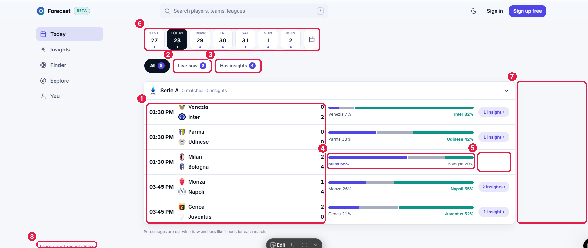

| # | What is wrong | Fix |
| --- | --- | --- |
| 1 | Finished matches show the kick-off time next to the final score. The bar still shows pre-match chances as if nothing happened. | Status first: **FT** (plus half-time score). Winner in bold, loser grey. Our call as a chip: "✓ Inter 82%" or "✗ Milan 55%". |
| 2 | "Live now 0" is shown | Hide any chip that would show 0 |
| 3 | Counts in filled purple discs outshout the labels | Plain number after the word: "With insights 4" |
| 4 | Milan 55% lost 2–4 and nothing says so | An "Upset" note when the favourite loses: honest, and people love upsets |
| 5 | Rows without insights leave a hole; the right column jumps | Keep the column, show the call chip there |
| 6 | No title, no headline: the day's best forecasts are on another page | One summary line plus **Standout forecasts today** (3 cards, swipe), each showing its result once finished |
| 7 | The right third of a wide screen is empty | Right column on computers (see Computer layout) |
| 8 | Footer links squeezed into the side menu | Move to the footer and to Explore / You |

**Redesign on a phone.**

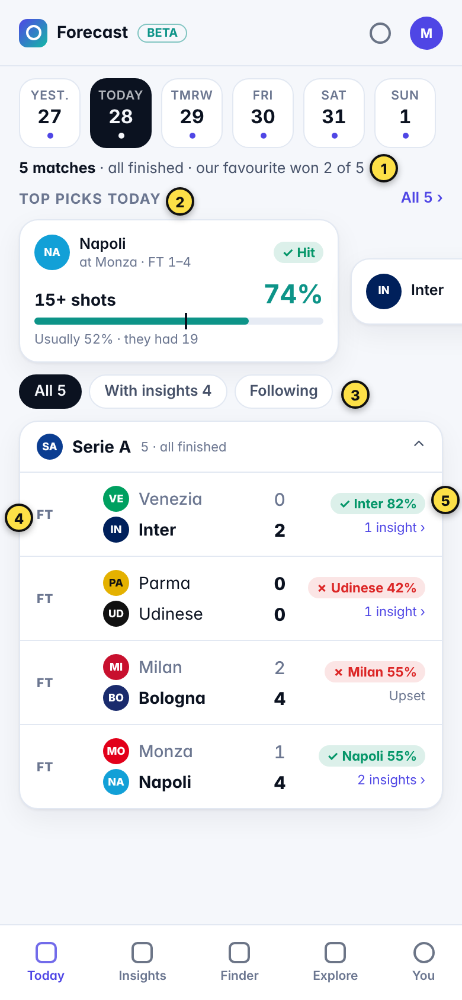

1. One line answers "how did today go?": "5 matches · all finished · our favourite won 2 of 5". It is honest even on a bad day, and that builds trust.
2. Standout forecasts today: swipeable cards. Once played, each shows "✓ Hit" and what happened ("they had 19").
3. Chips: no zero counts, no discs.
4. FT in the time column; the winner in bold; the home team stays on top.
5. Our call, marked right or wrong, with the insights link under it.

**One row, four states.** The row must change with the match. Upcoming shows the countdown; live shows the minute in red and the last event; finished shows FT and our call.

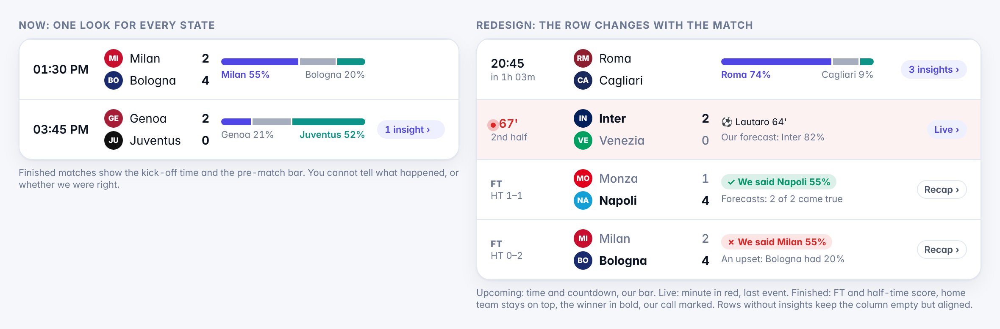

## Insights

The first forecast card starts 510 px down the page. On a phone, four rows of chips would fill the whole first screen. The filters must shrink to one row, and the card must say something specific.

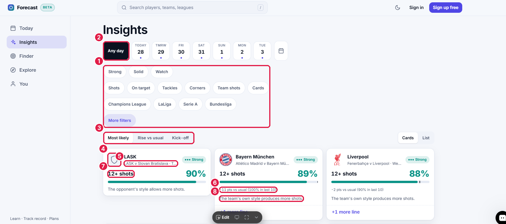

| # | What is wrong | Fix |
| --- | --- | --- |
| 1 | 14 chips in 4 rows (tier, market, league, more) before any result | One row of dropdown chips: **Strong + Solid ▾ · Market ▾ · League ▾ · ⚙ 2**. The rest goes in a Filters sheet |
| 2 | "Any day" is a black square, bigger than the day pills | Same pill shape as the days, first in the row |
| 3 | Default order "Most likely" | "Different from usual" first (update 25). Rename "Rise vs usual" so a beginner understands it |
| 4 | Grey shield for LASK | A coloured initial badge until the crest arrives (doc 19 review queue) |
| 5 | Match and date cut off: "LASK v Slovan Bratislava · T…" | Line 2 = opponent and venue ("vs Slovan Bratislava · home"); the date goes to the card footer |
| 6 | "−11 pts vs usual (100% in last 10)" on an 89% forecast reads as bad news, and uses the least reliable number | "Usually 58%" plus "▲ 23 pts" in green (update 25) |
| 7 | "12+ shots" on all three cards | Lines fitted to each team (update 25): 16+, 17+, 9+ |
| 8 | The same reason on every card | The strongest reason about this match (update 25) |

**Redesign on a phone.**

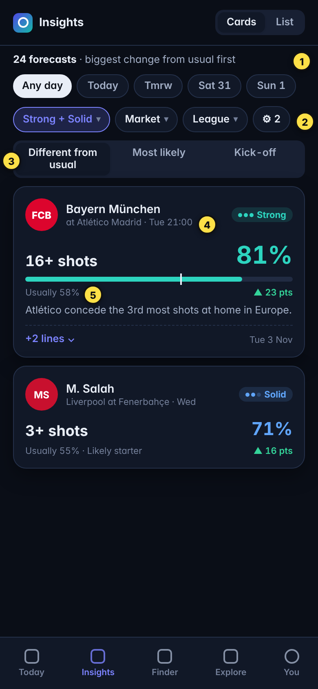

1. The title becomes the answer: "24 forecasts · biggest change first".
2. One row of dropdown chips, the active one tinted. "⚙ 2" shows how many extra filters are on.
3. Sort as a full-width segmented control, the new default first.
4. Opponent and venue on line two, never cut.
5. "Usually 58%" on the left, the lift on the right, the tick on the bar.

**The filter sheet** holds everything that was in the four chip rows, plus the likelihood slider. The button shows the live count before you close it.

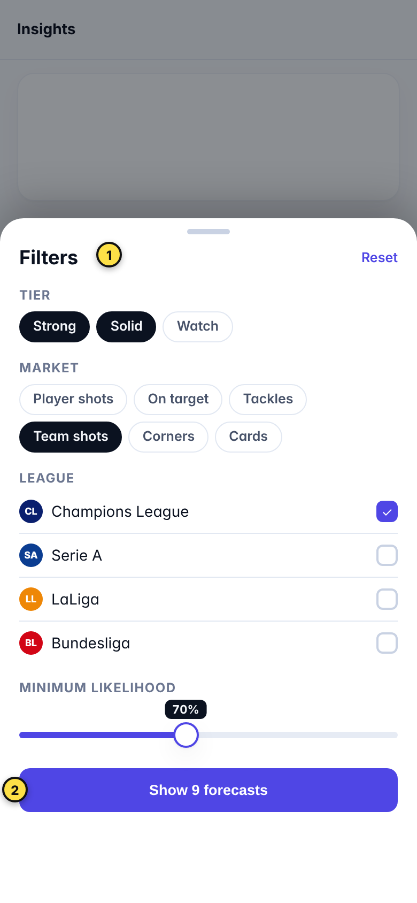

**The card, before and after.** This is the most-seen element of the app, so it gets the most care.

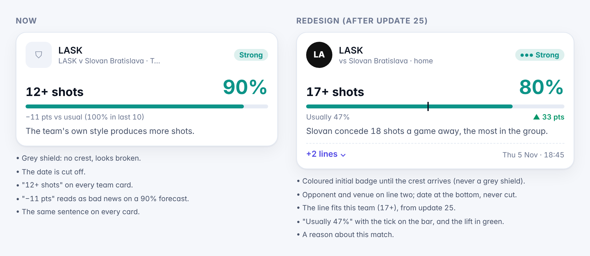

Rules for the card:

- **Shape:** one height for a row of cards on computers.
- **Lines:** "+2 lines" in the footer, left; the date right.
- **Tier colour:** the big percentage takes the tier's colour (teal Strong, blue Solid, amber Watch), so the tier reads before the badge does.

## Finder

The sentence builder is the right idea and already reads well. Two things block it from working:

- it cannot run until you pick a league;
- the free-search limit takes more room than the results.

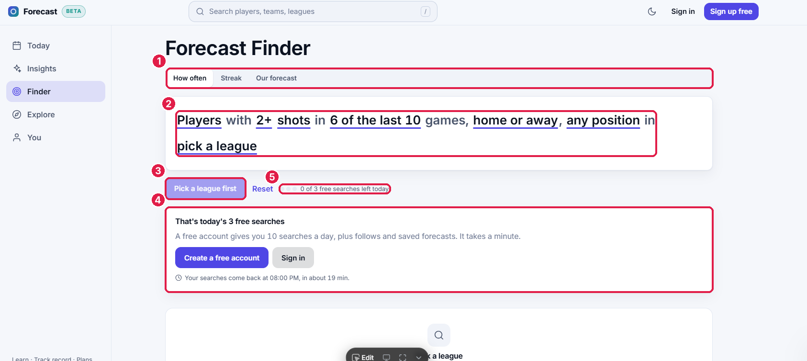

| # | What is wrong | Fix |
| --- | --- | --- |
| 1 | The mode tabs (How often / Streak / Our forecast) span the full width above the sentence, mostly empty grey | A small segmented control **under** the sentence, next to the result count: the sentence is the question, the mode is how to show the answer |
| 2 | Every word is underlined, "Players" included. Thick underlines read as links, not choices, and are small targets on a phone. | Each choice is a tinted token with a ▾ (44 px tall). Plain words stay plain. |
| 3 | "Pick a league first": the page opens with a disabled button and no results | Pre-pick a league: the user's followed league, else the league with the most matches this week. Results show on arrival; every change re-runs the search. No Search button. |
| 4 | The limit message is a 180 px box above the results | A slim bar above the bottom tabs: "2 of 3 free searches left · Get 10 a day, free ›". At 0 it becomes a sheet with the sign-up. |
| 5 | "0 of 3" with three empty dots, before the person has done anything | Count only searches actually run; show the counter only from the second search |

**Redesign on a phone.**

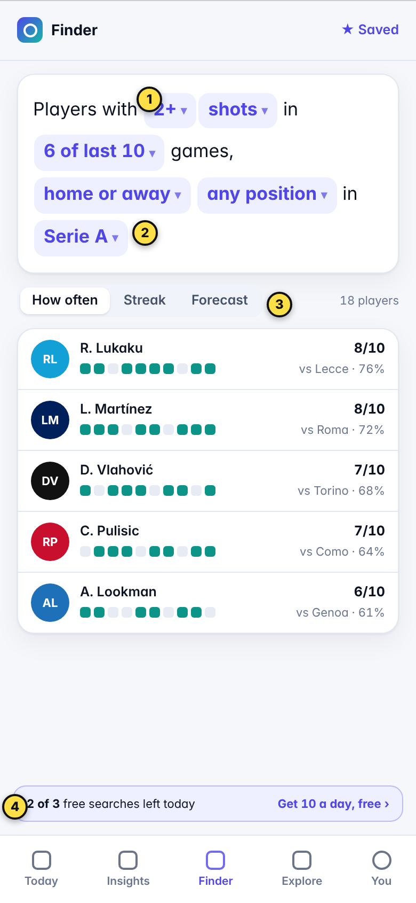

1. Tokens look tappable: a tinted chip with ▾.
2. League pre-picked, so results show at once.
3. Mode tabs sit small under the sentence, with "18 players".
4. Each result shows the 10-game strip, the hits ("8/10") and our forecast for the next game. The limit is a slim bar.

**Each token opens a small sheet**, never a form. The count of players updates while you slide.

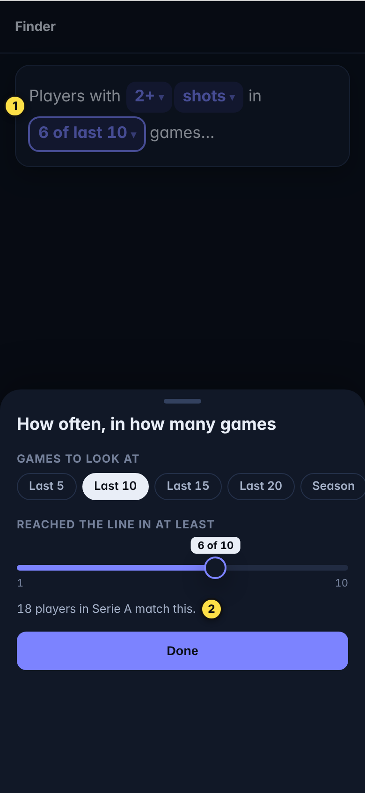

## Explore

The league tiles are good, but they show wrong round numbers, and the Tools list repeats the menu. On a phone, Explore should be a fast list: your teams, leagues with what's next, three tools.

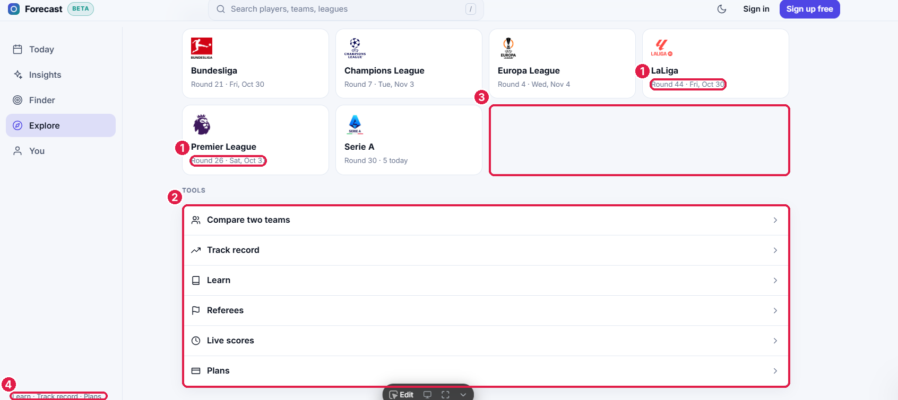

| # | What is wrong | Fix |
| --- | --- | --- |
| 1 | **"LaLiga Round 44", "Premier League Round 26" in October.** LaLiga has 38 rounds. | The page reads our internal `round`, which counts match dates since our history began (doc 07), not the matchday. Use the provider's matchday when the feed has it; otherwise show only the next date and match count ("Fri 30 Oct · 10 matches"). |
| 2 | Tools has 6 rows: Compare, Track record, Learn, Referees, Live scores, Plans. Three of them are already in the footer, and Live is buried. | Keep 3 tools: Compare, Referees, Track record. Live = the live pill and the live strip on Today. Learn = footer and the "?" on cards. Plans = You. |
| 3 | An empty slot after Serie A in the grid | A "Follow your teams" card in that place for visitors; "Your teams" for members |
| 4 | Footer links in the side menu repeat Tools | One footer, at the bottom of each page |

**Redesign on a phone.**

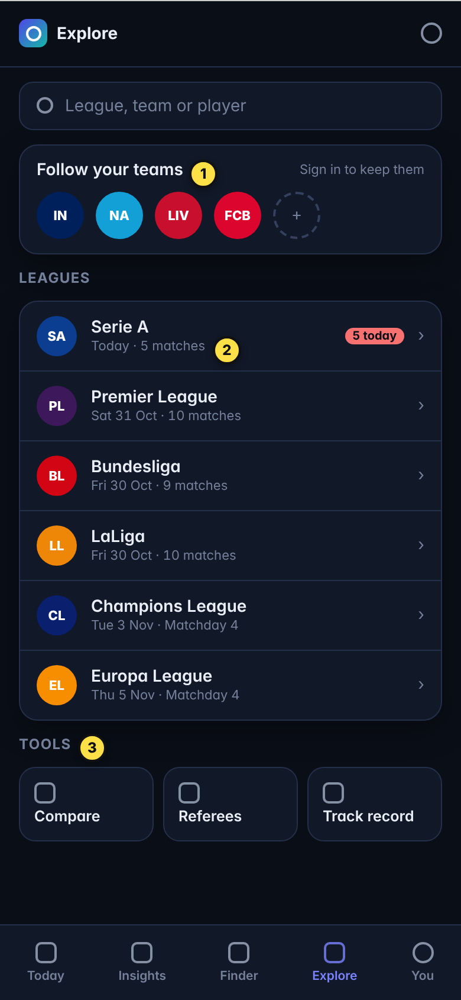

1. **Follow your teams** fills the empty slot and starts the habit loop. For members it becomes "Your teams".
2. **Leagues as a list** on phones:
   - logo, name and what's next ("Sat 31 Oct · 10 matches");
   - a red "5 today" badge when there are matches today;
   - no round numbers until they are correct.
3. **Three tools** as tiles.

## Computer layout

On wide screens, keep the reading width and turn the empty third into a right column. It holds three things people check on every visit.

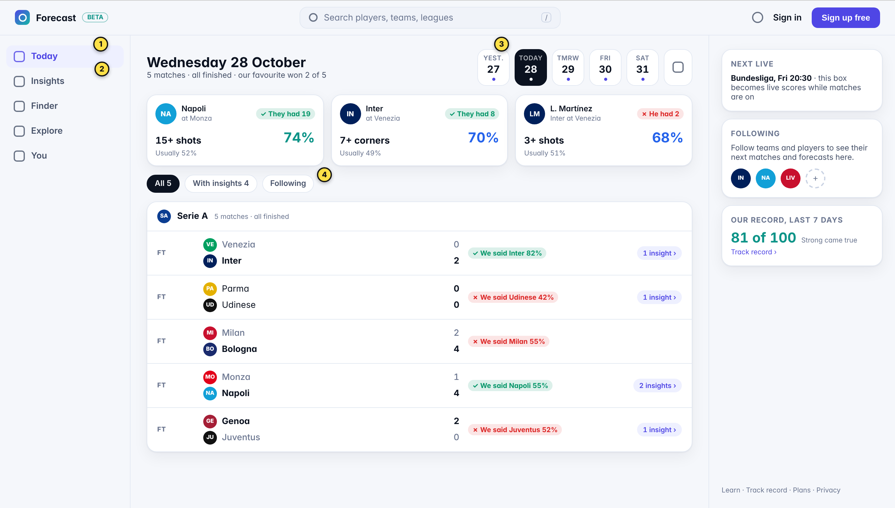

1. **A real title:** the day ("Wednesday 28 October") and the verdict line. The date strip moves to the right of the title.
2. **Standout forecasts:** three across, each with its result once played ("✓ They had 19", "✗ He had 2").
3. **The right column** (shown from 1,280 px wide):
   - **Live:** live scores while matches are on; otherwise the next kick-off. Never a "0".
   - **Following:** your teams' next matches; for visitors, a follow prompt.
   - **Our record, last 7 days:** "81 of 100 Strong came true", linked to Track record.
   - The footer links at the bottom.
4. **Our call on every finished row:** "✓ We said Inter 82%" or "✗ We said Milan 55%".

Breakpoints:

| Width | Layout |
| --- | --- |
| Under 640 px | Bottom tab bar, one column, cards full width |
| 640 to 1,279 px | Left menu, one column up to 900 px wide |
| 1,280 px and up | Left menu, main column up to 960 px, right column 300 px |

## Fix list for Emergent

In this order. Bugs first, then the changes every page shares, then page by page. Install update 25 before item 3: several card fixes depend on its fields.

| # | Page | Change | Data it uses |
| --- | --- | --- | --- |
| 1 | Today | Match row by status: time + countdown / live minute in red + last event / FT + half-time score; winner bold; home team on top | `status`, `hg`, `ag`, live fields (doc 23); half-time only if the feed has it |
| 2 | Explore | Remove "Round N". Show the provider matchday if present, else next date + match count | match `matchday` from the feed; never our `round` |
| 3 | All | Install update 25 (fitted lines, "Usually X%", sort by change, reasons, likely starters) | doc 25 |
| 4 | All | Hide zero chips and counts; counts as plain muted numbers, no discs | counts already returned |
| 5 | All, phones | Bottom tab bar (Today, Insights, Finder, Explore, You); footer links move to the footer | none |
| 6 | Today | Our call chip on finished rows: ✓ / ✗ + the favourite's %; "Upset" when the favourite lost | `probs` + final score |
| 7 | Today | Summary line: matches, status, "our favourite won N of M" | computed on the page from the rows |
| 8 | Today | Standout forecasts today: 3 cards (swipe on phones), result once played | `GET /api/insights?sort=edge&limit=3`, filtered to the day; outcomes for finished matches |
| 9 | Insights | One row of dropdown chips (Tier, Market, League, ⚙ count); everything else in a Filters sheet with a live count; "Any day" as a normal pill | `GET /api/insights?tiers=&stat=&scope=&leagues=` |
| 10 | Insights | Card: initial badge instead of the grey shield; line 2 = opponent + venue; date in the footer; "Usually X%" + lift; tier colour on the %; equal heights in a row | `team`, `opp`, `p_usual`, `edge`, `tier` |
| 11 | Finder | Tokens as tinted chips with ▾, 44 px; plain words plain | none |
| 12 | Finder | Pre-pick a league (followed, else busiest this week); results on arrival; re-run on every change; no Search button | `GET /api/finder` |
| 13 | Finder | Mode tabs small, under the sentence, next to the count | none |
| 14 | Finder | Limit as a slim bar above the tabs; a sheet only at 0; count only searches actually run | plan entitlements (doc 13) |
| 15 | Explore | Leagues as a list on phones (logo, name, what's next, "N today" badge); tiles on computers | league next-match date and count |
| 16 | Explore | "Follow your teams" card for visitors, "Your teams" for members | `GET /api/me/follows` |
| 17 | Explore | Tools down to Compare, Referees, Track record; Live via the pill, Learn in the footer, Plans in You | none |
| 18 | Today, computer | Real title + verdict line; right column from 1,280 px: Live / next kick-off, Following, Our record | live routes, follows, `GET /api/track-record` |

**Prompt to paste** (after update 25):

> Read `docs/26_design_review.md` with every picture in `docs/review/pictures/` and `docs/24_ui_redesign.md`.
>
> - Make the 18 changes in its fix list, in order. Use the pictures as the target, in our existing tokens.
> - Frontend only: do not change `backend/`. If a field is missing, hide that element and list it in `docs/redesign/DATA_GAPS.md`.
> - Test each page at 390 px and 1280 px, light and dark, and send me screenshots after items 2, 8, 10, 14 and 18.
> - Run `yarn check-copy` and `cd backend && bash run_tests.sh` (18 PASS) before you finish.
